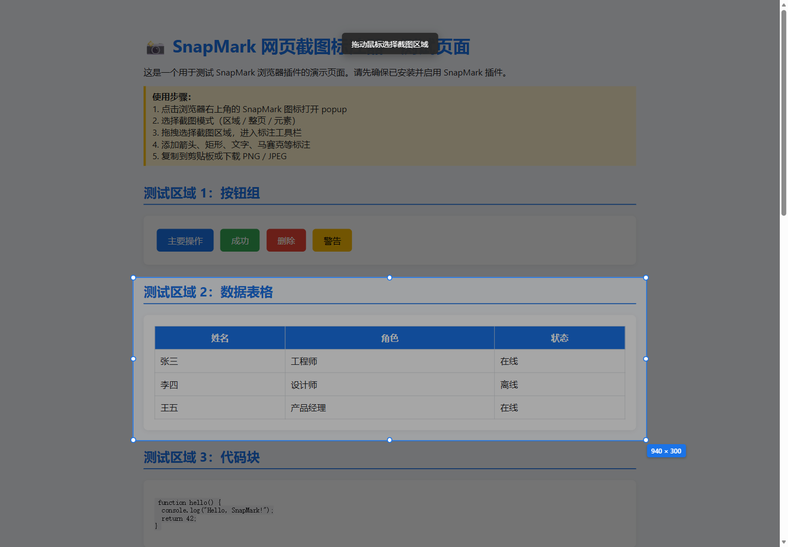
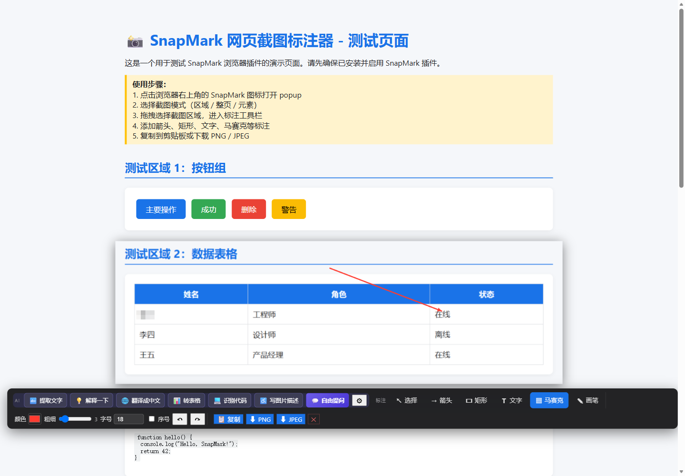
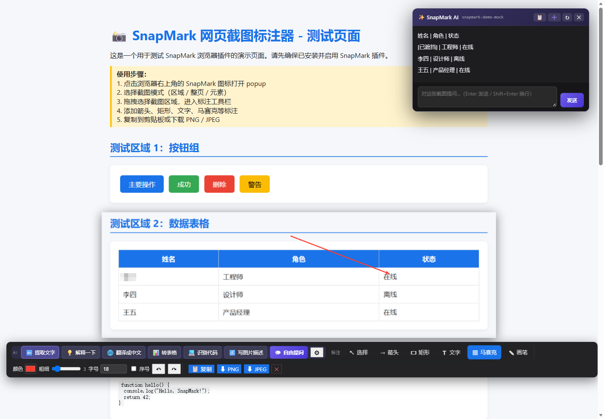
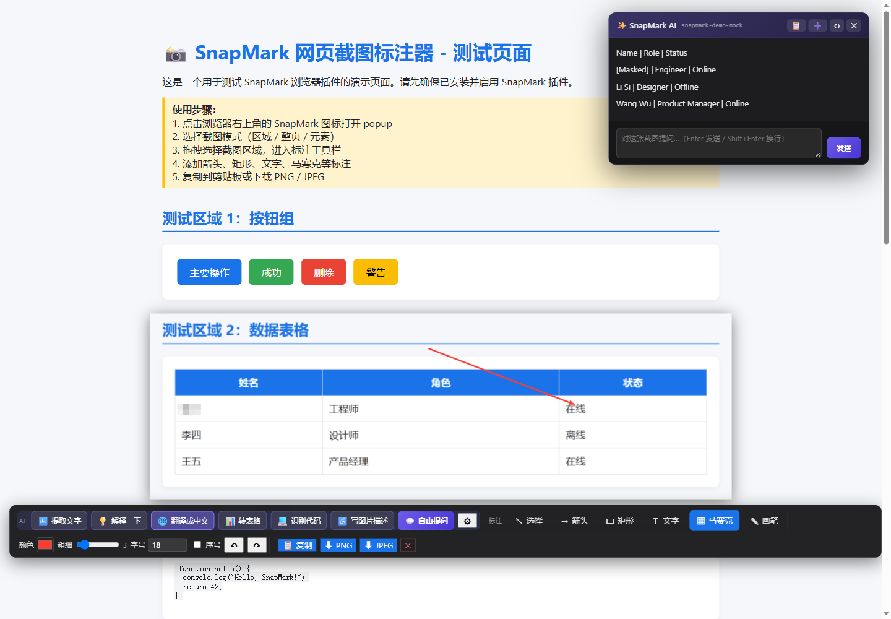
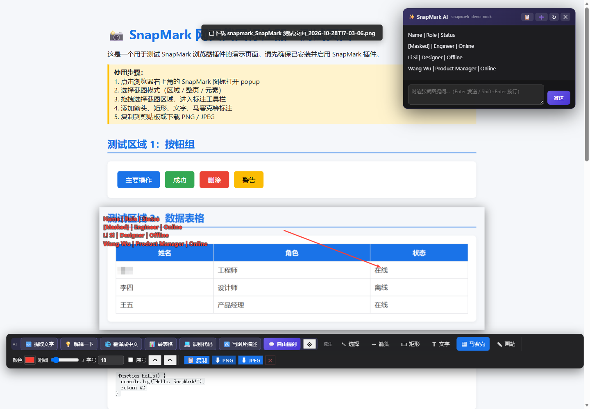

# SnapMark 真实扩展演示：从区域截图到 AI 写回

> 本页录像来自真实 Chromium MV3 扩展操作。截图、Canvas 标注、Service Worker 消息路由、SSE 解析、AI 结果写回和 PNG 下载均走项目代码；仅视觉模型由本机确定性 mock 替代，**不调用上游模型 API**。

## 视频

<video controls playsinline preload="metadata" poster="demo/web/02-arrow-and-mosaic.png" src="demo/web/SnapMark-demo.mp4" width="100%"></video>

**[直接打开 / 下载 MP4](demo/web/SnapMark-demo.mp4)** · [查看实际导出的 PNG](demo/web/SnapMark-annotated.png) · [项目源码与安装说明](../README.md)

录像流程：框选数据表格 → 添加箭头 → 马赛克隐藏首行姓名 → OCR 流式输出 → 翻译成英文 → 将翻译写回图片 → 下载 PNG。

## 这次运行实际验证了什么

| 验证项 | 本次结果 |
| --- | --- |
| 浏览器与扩展 | Edge / Chromium，真实 MV3 Service Worker 与 content script |
| 区域截图 | 940 × 300 CSS 像素选区，实际调用 `chrome.tabs.captureVisibleTab` |
| AI 请求 | 2 次真实 HTTP / SSE 请求：OCR、翻译；模型名显示为 `snapmark-demo-mock` |
| 写回图片 | 写回前后 Canvas 数据发生变化，不是只更新面板文本 |
| PNG 导出 | 扩展实际下载 1175 × 375 PNG，文件可解码且 SHA-256 已记录 |
| 运行健康 | 无页面脚本错误、无外部网络请求；23 项静态自检通过 |

录制前还修复了两个由真实浏览器验证发现的问题：`captureVisibleTab` 现在接收正确的 `windowId`，选区阶段也不会再访问尚未创建的标注画布。

## 关键截图

### 1. 拖拽框选网页区域



### 2. 箭头与马赛克标注

箭头指向首行“在线”状态，首行姓名已像素化。发送给 AI 的图像包含这些标注。



### 3. OCR 流式结果

content script 通过长连接接收 background 解析的 SSE 分块，右侧面板逐步渲染。



### 4. 翻译结果与 mock 标识

面板明确显示 `snapmark-demo-mock`，不会把固定演示文本伪装成真实模型输出。



### 5. AI 写回与 PNG 导出

翻译被添加为四行真实文字标注，随后通过 `chrome.downloads` 导出合成图像。



## 本地复现

只使用 Python 标准库即可启动测试网页和 mock 接口：

```bash
python docs/demo_server.py
```

然后在 Chromium 浏览器的开发者模式中加载本仓库根目录作为已解压扩展，在设置页填写：

- Base URL：`http://127.0.0.1:8765/v1`
- API Key：`demo-local-key`（仅为本地测试约定，不是真实凭据）
- Model：`snapmark-demo-mock`

点击“测试连接”，再打开 `http://127.0.0.1:8765/test-page.html` 即可操作。接入真实视觉模型时，请改用自己的服务商配置和 Key，不要把真实 Key 写入仓库或录像。

## 演示边界

`docs/demo_server.py` 根据预设任务返回固定 OCR / 翻译文本，用于离线、可重复地验证扩展工程链路。它不是 OCR 引擎或视觉模型；本页内容**不代表真实模型识别准确率、翻译质量或生产环境表现**。
